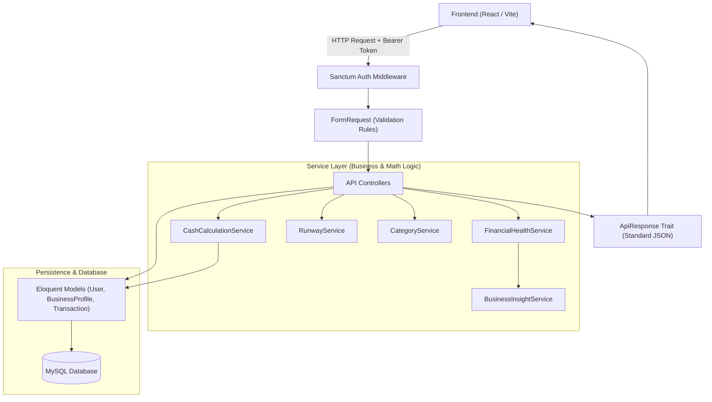

# 📋 Dokumentasi Implementasi Backend: UMKM Financial Health Platform

Dokumen ini merangkum seluruh pekerjaan backend yang telah diimplementasikan pada branch `feature/backend`. Seluruh fitur, skema response, logika bisnis, dan isolasi data telah dibangun sesuai dengan **Product Requirements Document (PRD)** dan **API Contract v1.0**.

---

## 📑 Daftar Isi
1. [Ringkasan Eksekutif](#1-ringkasan-eksekutif)
2. [Arsitektur & Pola Desain](#2-arsitektur--pola-desain)
3. [Skema Database & Relasi](#3-skema-database--relasi)
4. [Daftar Endpoint API (14 Endpoint Lengkap)](#4-daftar-endpoint-api-14-endpoint-lengkap)
5. [Logika Bisnis & Mesin Perhitungan Finansial](#5-logika-bisnis--mesin-perhitungan-finansial)
6. [Data Demo & Seeder](#6-data-demo--seeder)
7. [Riwayat Commit Git](#7-riwayat-commit-git)
8. [Panduan Menjalankan & Testing](#8-panduan-menjalankan--testing)

---

## 1. Ringkasan Eksekutif

- **Framework & Runtime:** Laravel 11 / PHP 8.4 CLI di dalam Docker
- **Autentikasi:** Laravel Sanctum (Bearer Token)
- **Database:** MySQL 8.4 LTS
- **Satuan Mata Uang:** Integer Rupiah (IDR) tanpa desimal dan simbol
- **Branch Kerja:** `feature/backend`
- **Total Endpoint:** 14 REST API Endpoints (2 Public, 12 Protected)

---

## 2. Arsitektur & Pola Desain

Backend mengadopsi arsitektur berlapis (*Service-Repository/Service Layer Pattern*) untuk memisahkan Controller (HTTP transport), FormRequest (validasi), Service (logika bisnis/matematika), dan Eloquent Model (persistensi database).



### Response Standard Global
Seluruh endpoint menghasilkan struktur JSON yang seragam via Trait `ApiResponse`:
- **Sukses (200 / 201):**
  ```json
  { "success": true, "message": "...", "data": {} }
  ```
- **Validasi Gagal (422):**
  ```json
  { "success": false, "message": "...", "errors": { "field": ["pesan error"] } }
  ```
- **Error Autentikasi (401) & Not Found (404):**
  ```json
  { "success": false, "message": "...", "errors": null }
  ```

---

## 3. Skema Database & Relasi

```mermaid
erDiagram
    users ||--|| business_profiles : "has one"
    users ||--o{ transactions : "owns"
    
    users {
        bigint id PK
        string name
        string email UK
        string password
        timestamps created_at_updated_at
    }
    
    business_profiles {
        bigint id PK
        bigint user_id FK, UK
        string business_name
        string business_type
        bigint opening_balance
        timestamps created_at_updated_at
    }
    
    transactions {
        bigint id PK
        bigint user_id FK, IDX
        enum type "income | expense"
        string category
        boolean is_operational
        bigint amount
        text description
        date transaction_date
        timestamps created_at_updated_at
    }
```

### Aturan Keamanan & Isolasi Data (*Multi-tenant User Isolation*)
Setiap query transaksi diikat langsung ke ID pengguna yang sedang login (`auth()->id()`). Pengguna A tidak dapat melihat, mengubah, atau menghapus transaksi milik Pengguna B. Jika ID yang diakses bukan milik pengguna aktif, sistem mengembalikan status HTTP `404 Not Found`.

---

## 4. Daftar Endpoint API (14 Endpoint Lengkap)

### 4.1 Autentikasi & Profil Pengguna
| Method | Endpoint | Auth | Deskripsi |
| :--- | :--- | :---: | :--- |
| `POST` | `/api/register` | Public | Registrasi akun sekaligus membuat profil bisnis awal dan menghasilkan Bearer token. |
| `POST` | `/api/login` | Public | Login akun dengan email & password, menghasilkan Bearer token Sanctum. |
| `POST` | `/api/logout` | Sanctum | Mencabut (*revoke*) token akses aktif saat ini. |
| `GET` | `/api/me` | Sanctum | Mengambil profil user aktif beserta relasi `business_profile`. |
| `GET` | `/api/business-profile` | Sanctum | Mengambil detail profil bisnis aktif pengguna. |
| `PUT` | `/api/business-profile` | Sanctum | Memperbarui nama bisnis, bidang usaha, atau saldo awal (`opening_balance`). |

### 4.2 Manajemen Kas & Transaksi (*Cash Management*)
| Method | Endpoint | Auth | Deskripsi |
| :--- | :--- | :---: | :--- |
| `GET` | `/api/transactions` | Sanctum | Daftar riwayat transaksi dengan filter (`type`, `category`, `from`, `to`) dan paginasi (default 15/page). |
| `POST` | `/api/transactions` | Sanctum | Mencatat transaksi kas masuk/keluar baru. Kolom `is_operational` otomatis diisi backend. |
| `GET` | `/api/transactions/{id}` | Sanctum | Mengambil detail satu transaksi milik pengguna aktif. |
| `PUT` | `/api/transactions/{id}` | Sanctum | Memperbarui nominal, kategori, tanggal, atau deskripsi transaksi. |
| `DELETE` | `/api/transactions/{id}` | Sanctum | Menghapus catatan transaksi. |

### 4.3 Dashboard & Analisis Finansial
| Method | Endpoint | Auth | Deskripsi |
| :--- | :--- | :---: | :--- |
| `GET` | `/api/dashboard` | Sanctum | Ringkasan kas (`available_cash`, `total_income`, `total_expense`, `operating_expense`, `non_operating_expense`, `net_cash_flow`, `average_daily_expense`), tren harian (`chart_daily_trend`), ringkasan skor kesehatan keuangan, dan status runway historis. |
| `GET` | `/api/financial-health` | Sanctum | Menghitung Financial Health Score (0–100) komposit, 3 rasio pembentuknya, dan rekomendasi insight berbasis aturan kontekstual. |
| `POST` | `/api/runway/simulate` | Sanctum | Menjalankan simulasi skenario "what-if" ketahanan kas tanpa memodifikasi catatan transaksi aktual di database. |

---

## 5. Logika Bisnis & Mesin Perhitungan Finansial

Seluruh rumus matematika dan aturan ambang batas (*threshold*) diimplementasikan di backend sebagai sumber kebenaran (*single source of truth*):

### A. Kas Tersedia (*Available Cash*)
$$\text{available\_cash} = \text{opening\_balance} + \sum \text{income} - \sum \text{expense}$$
Dihitung secara kumulatif dari seluruh transaksi sejak bisnis pertama kali mencatat transaksi.

### B. Financial Health Score (Bobot Komposit 100%)
$$\text{Score} = \text{round}\Big(0{,}35 \cdot S_{\text{coverage}} + 0{,}35 \cdot S_{\text{oer}} + 0{,}30 \cdot S_{\text{margin}}\Big)$$

1. **Cash Coverage (Bobot 35%):**
   $$\text{cash\_coverage\_months} = \frac{\text{available\_cash}}{\frac{\text{operating\_expense}}{N} \times 30}$$
   - Skor: $\ge 3$ bln (100), $2 - <3$ bln (85), $1 - <2$ bln (70), $0{,}5 - <1$ bln (40), $< 0{,}5$ bln (20).
2. **Operating Expense Ratio / OER (Bobot 35%):**
   $$\text{OER} = \frac{\text{operating\_expense}}{\text{total\_income}} \times 100\%$$
   - Skor: $\le 30\%$ (100), $>30\% - 50\%$ (85), $>50\% - 70\%$ (70), $>70\% - 90\%$ (40), $>90\%$ (20).
3. **Net Cash Flow Margin (Bobot 30%):**
   $$\text{margin} = \frac{\text{total\_income} - \text{total\_expense}}{\text{total\_income}} \times 100\%$$
   - Skor: $\ge 20\%$ (100), $10\% - <20\%$ (85), $0\% - <10\%$ (70), $-10\% - <0\%$ (40), $<-10\%$ (20).

> [!NOTE]
> **Penanganan Data Kurang (Edge Cases):**
> Jika `total_income == 0` atau `operating_expense == 0`, sistem tidak memaksakan angka dan tidak membagi dengan nol (*zero division safe*). Status dikembalikan sebagai `"insufficient_data"` dengan nilai `score: null`.

### C. Smart Runway Simulator & Enums
- $\text{simulated\_daily\_net\_burn} = \text{daily\_expense\_assumption} - \text{daily\_income\_assumption}$
- $\text{simulated\_runway\_days} = \lfloor \frac{\text{available\_cash}}{\text{simulated\_daily\_net\_burn}} \rfloor$
- **Status Enum:**
  - `net_burn`: burn $> 0$ dan kas $> 0$
  - `positive_cash_flow`: pemasukan $\ge$ pengeluaran (`runway_days: null`)
  - `break_even`: pemasukan $=$ pengeluaran (`runway_days: null`)
  - `insufficient_cash`: kas $\le 0$ saat simulasi dijalankan (`runway_days: null`)

---

## 6. Data Demo & Seeder

Telah dibuat seeder demo khusus: `DemoBusinessSeeder.php` yang siap dipanggil saat demonstrasi aplikasi:
- **Akun Pemilik:**
  - Email: `budi@warungberkah.test`
  - Password: `password123`
  - Nama: `Budi Santoso`
- **Profil Usaha:**
  - Nama Usaha: `Warung Makan Berkah`
  - Bidang: `Kuliner / F&B`
  - Saldo Awal: `Rp2.000.000`
- **Transaksi Realistis 30 Hari:**
  - Mencakup pemasukan penjualan harian berkala (`sales`)
  - Pengeluaran operasional (bahan baku `raw_materials`, sewa tempat `rent`, utilitas `utilities`, gaji `salaries`, promosi `marketing`)
  - Pengeluaran non-operasional (pembelian peralatan `asset_purchase`, pembayaran utang `loan_principal`, prive `owner_withdrawal`)
  - Menghasilkan status kas positif dengan skor kesehatan kategori **Cukup Sehat (Fair)** atau **Sehat (Healthy)**.

---

## 7. Riwayat Commit Git (Branch `feature/backend`)

Riwayat commit telah disusun rapi sesuai pedoman [CONTRIBUTING.md](../CONTRIBUTING.md):

1. `fb5e404` - `chore: inisialisasi backend`
2. `0289629` - `feat(auth): Implementasi Autentikasi dan Profil Bisnis dengan Laravel Sanctum`
3. `0b13782` - `feat: implementasi crud transaksi dan deteksi otomatis kategori operasional`
4. `570b8b3` - `feat: implementasi endpoint dashboard agregasi kas dan tren arus kas`
5. `f399415` - `feat: implementasi financial health engine dan insight bisnis`
6. `90940fe` - `feat: implementasi simulator runway dan integrasi ke dashboard`
7. `f4784ad` - `test: menambahkan seeder data demo warung berkah 30 hari`

---

## 8. Panduan Menjalankan & Testing

### 1. Menjalankan Migrasi & Database Seeder:
```bash
docker compose exec backend php artisan migrate:fresh --seed
```

### 2. Menjalankan Seeder Demo Khusus:
```bash
docker compose exec backend php artisan db:seed --class=DemoBusinessSeeder
```

### 3. Memverifikasi Rute API yang Terdaftar:
```bash
docker compose exec backend php artisan route:list --path=api
```
